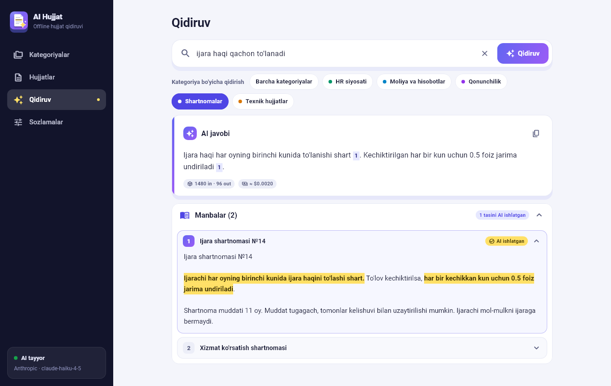
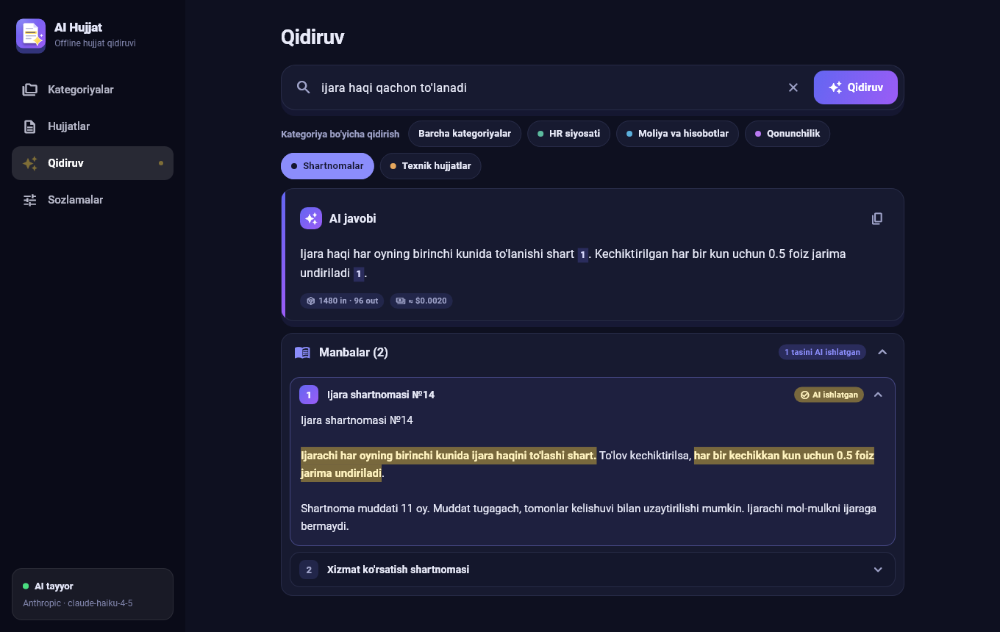
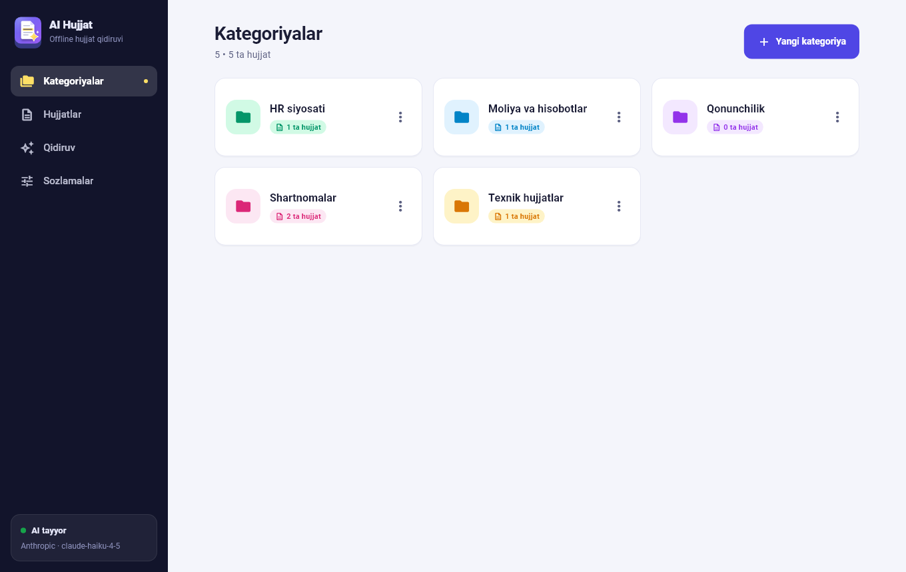
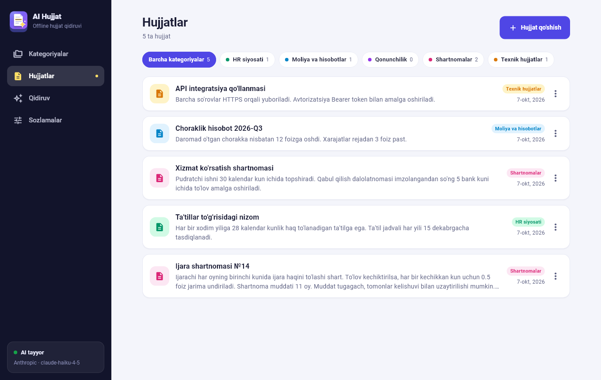
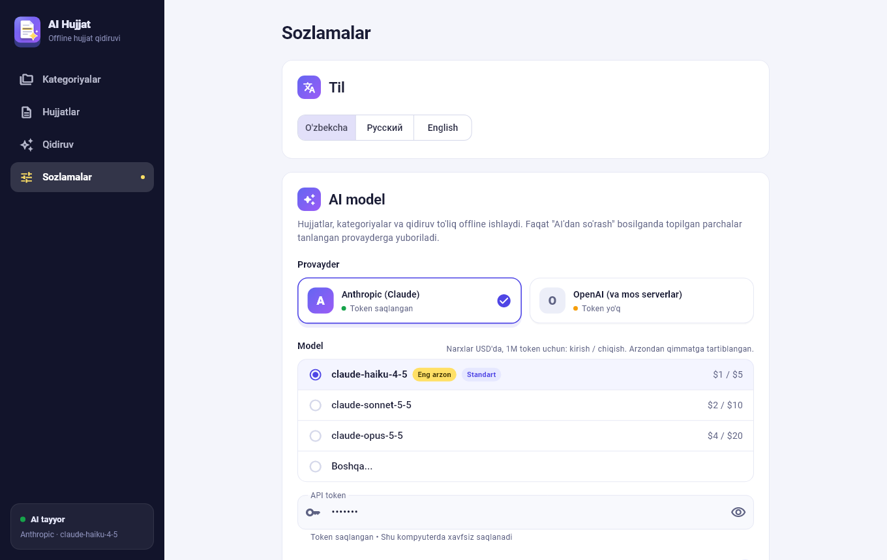
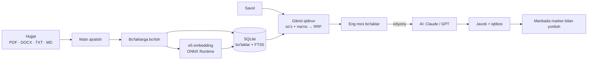

<div align="center">


# AI Hujjat

**Hujjatlaringizdan so'rang.** Kompyuteringizdagi hujjatlar bo'yicha qidiruv va savol-javob ilovasi:
javob manbalari bilan keladi, AI aynan qaysi joydan foydalanganini esa marker bilan ko'rsatadi.

[](LICENSE)


</div>

<p align="center">
  
</p>

> Skrinshotlar namunaviy ma'lumotlar bilan olingan.

## Imkoniyatlar

- **Kategoriyalar va hujjatlar.** To'liq CRUD (yaratish, ko'rish, tahrirlash, o'chirish), hammasi ilovaning o'zida.
- **Hujjat yuklash.** Matnni qo'lda kiriting yoki `.pdf`, `.docx`, `.txt`, `.md` faylni yuklang.
- **Kategoriya bo'yicha qidiruv.** Qidiruv tanlangan kategoriya ichida bajariladi (yoki barcha kategoriyalarda).
- **Gibrid qidiruv.** So'z bo'yicha (SQLite FTS5) va ma'no bo'yicha (mahalliy embedding modeli) natijalar
  birlashtiriladi. Ikkalasi ham **internetsiz** ishlaydi.
- **AI javob va aniq iqtibos.** Savol berganingizda topilgan parchalar tanlangan AI'ga yuboriladi.
  Javobdagi `[1]` havolasini bossangiz, manba ochiladi va AI tayanib o'tgan jumlalar marker bilan yoritiladi.
- **Arzondan qimmatga tartiblangan modellar.** Sozlamalarda Anthropic (Claude) va OpenAI modellari
  narxi bilan ko'rsatiladi. Har bir javob ostida sarflangan tokenlar va taxminiy narx chiqadi.
- **Uch tilda:** o'zbekcha, ruscha, inglizcha. Yorug' va qorong'i mavzu.
- **Xavfsiz token.** API kaliti Windows DPAPI bilan shifrlanib, faqat sizning hisobingizda saqlanadi.

<details>
<summary>Boshqa ekranlar</summary>

| Qorong'i mavzu | Kategoriyalar |
|---|---|
|  |  |

| Hujjatlar | Sozlamalar |
|---|---|
|  |  |

</details>

## O'rnatish (tayyor dastur)

[**Releases**](../../releases) sahifasidan `AI_Hujjat_Setup_<versiya>.exe` ni yuklab, ishga tushiring.
Administrator huquqi shart emas, dastur sizning foydalanuvchi papkangizga o'rnatiladi.
Embedding modeli va barcha kutubxonalar o'rnatuvchi ichida bor.

> **Eslatma:** o'rnatuvchi hozircha raqamli imzolanmagan, shuning uchun Windows SmartScreen
> "noma'lum nashriyotchi" deb ogohlantirishi mumkin. "Qo'shimcha ma'lumot" → "Baribir ishga tushirish"
> ni bosing. Ishonchingiz komil bo'lmasa, quyidagi bo'limdan o'zingiz manbadan yig'ishingiz mumkin.

AI javoblari uchun **Sozlamalar → AI model** bo'limida provayderni tanlab, o'z **API tokeningizni**
kiriting ([Anthropic](https://console.anthropic.com/) yoki [OpenAI](https://platform.openai.com/)).
Token kiritilmasa ham kategoriyalar, hujjatlar va qidiruv ishlaydi, faqat AI javobi chiqmaydi.

## Manbadan ishga tushirish

**Kerak bo'ladi:** Windows 10/11, [Flutter](https://docs.flutter.dev/get-started/install/windows/desktop) (3.41 bilan sinalgan) va
Visual Studio Build Tools ("Desktop development with C++" ish yuki).

```bash
git clone https://github.com/Alfraganus/ai-hujjat.git
cd ai-hujjat

# Embedding modeli (~135 MB) repozitoriyga kirmagan, uni yuklab oling:
powershell -ExecutionPolicy Bypass -File tool/download_model.ps1

flutter pub get
flutter run -d windows
```

Model fayllarisiz ilova ishlaydi, lekin ma'no bo'yicha qidiruv o'chiq bo'ladi (faqat so'z bo'yicha qidiradi).

```bash
flutter analyze    # statik tekshiruv
flutter test       # testlar
```

### Installer yig'ish

[Inno Setup 6](https://jrsoftware.org/isinfo.php) o'rnatilgan bo'lsa (`winget install JRSoftware.InnoSetup`):

```bash
powershell -ExecutionPolicy Bypass -File tool/build_installer.ps1
```

Natija: `dist/AI_Hujjat_Setup_<versiya>.exe`. Skript release build qiladi, Visual C++ runtime fayllarini
qo'shadi va installerni yig'adi.

## Qanday ishlaydi



- **Saqlash:** bitta SQLite fayl. Kategoriya, hujjat, bo'laklar, FTS5 indeksi va vektorlar shu yerda.
- **Qidiruv:** FTS5 (BM25) va `multilingual-e5-small` (int8, ONNX) natijalari Reciprocal Rank Fusion bilan
  birlashtiriladi. Vektorlar oddiy jadvalda saqlanadi, o'xshashlik Dart'da hisoblanadi, shuning uchun
  qo'shimcha native kengaytma kerak emas.
- **AI javob:** faqat topilgan eng mos parchalar yuboriladi. Model JSON qaytaradi: javob matni va
  har bir manba uchun hujjatdan aynan ko'chirilgan iqtibos. Ilova iqtibosni bo'lakdan topib yoritadi.
- **Hech narsa yuborilmasa:** AI sozlanmagan bo'lsa yoki hech narsa topilmasa, so'rov tashqariga chiqmaydi.

## Maxfiylik va xavfsizlik

- Hujjatlaringiz va qidiruv **kompyuteringizda** qoladi (`%APPDATA%\uz.aihujjat\AI Hujjat\`).
- Tashqariga faqat siz **savol berganingizda** chiqadi: savolingiz va topilgan eng mos
  parchalar (Sozlamalarda 1–10 ta) tanlangan provayderga (Anthropic yoki OpenAI) yuboriladi.
  Provayderning o'z maxfiylik siyosati amal qiladi. Maxfiy hujjatlar uchun avval shuni o'ylab ko'ring.
- API tokeni sozlamalar faylida Windows DPAPI bilan **shifrlangan** holda turadi (boshqa foydalanuvchi
  yoki boshqa kompyuter uni ocha olmaydi). Token repozitoriyda yoki jurnalda saqlanmaydi.
- Ilova hech qanday statistika yoki telemetriya yubormaydi.
- Xatolar jurnali: `%APPDATA%\uz.aihujjat\AI Hujjat\app.log` (hujjat matni yoki token yozilmaydi).

Xavfsizlik bo'yicha muammo topsangiz, ochiq masala (Issue) ochishdan oldin muallif bilan GitHub orqali
bog'laning.

## Cheklovlar

- Faqat **Windows** (token himoyasi hozircha Windows DPAPI'ga tayanadi).
- **Skaner qilingan PDF** (rasm) matnini o'qimaydi, OCR yo'q. Jadval tuzilmasi saqlanmaydi, eski `.doc` yo'q.
- **Ma'no bo'yicha qidiruv mukammal emas**, ayniqsa o'zbek lotin yozuvida: o'lchovlarda to'g'ri va noto'g'ri
  natijalarning o'xshashlik ballari ustma-ust tushdi, shuning uchun ball chegarasi qo'yilmagan va u so'z
  bo'yicha qidiruv bilan birlashtiriladi. Bema'ni savolda ham eng yaqin bo'laklar topiladi, AI esa
  "javob topilmadi" deyishi kerak.
- Model narxlari ilovada qo'lda yozilgan ro'yxat ([`llm_catalog.dart`](lib/services/llm_catalog.dart)),
  vaqt o'tib eskirishi mumkin.
- Avtomatik yangilanish yo'q: yangi versiyani qo'lda o'rnatasiz.

## Loyiha tuzilmasi

```
lib/
  data/        SQLite, bo'laklarga bo'lish, eski ma'lumotlarni ko'chirish
  services/    embedding, qidiruv, AI (Anthropic/OpenAI), sozlamalar, matn ajratish
  ui/          sahifalar, mavzu, logotip
  l10n/        tarjimalar (uz, ru, en)
test/          birlik va vidjet testlari
integration_test/  haqiqiy ONNX modeli bilan test
installer/     Inno Setup skripti
tool/          model yuklash, installer yig'ish, ikonka yasash
```

## Hissa qo'shish

Takliflar va pull request'lar xush kelibdi: [CONTRIBUTING.md](CONTRIBUTING.md).

## Litsenziya

[MIT](LICENSE). Uchinchi tomon komponentlari (model, ONNX Runtime, PDFium va boshqalar) o'z
litsenziyalari bilan keladi: [NOTICE.md](NOTICE.md).
